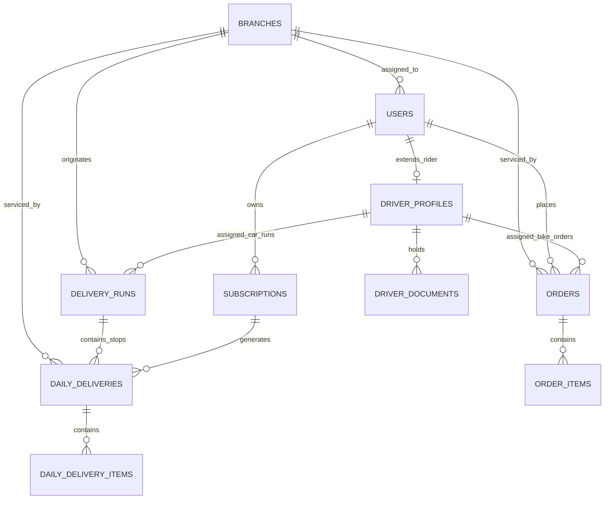

# AHAAR Delivery System — Technical Architecture Specification

**Document:** `docs/architecture.md`  
**Date:** November 2026  
**Auditor:** Senior Software Architect & Delivery Operations Consultant  
**Status:** Approved Specification  

---

## 1. System Topology & Component Interactions

The AHAAR ecosystem consists of four interconnected applications centered around a single Laravel backend:

```
┌────────────────────────────────────────────────────────────────────────┐
│                        AHAAR ECOSYSTEM TOPOLOGY                        │
└────────────────────────────────────────────────────────────────────────┘

  Customer Mobile App                    Next.js Admin Panel
  (ahaar-app / Expo SDK 57)              (ahaar / Next.js 15 App Router)
  • Browsing, Plans, Swaps               • Kitchen Prep & Packing Sheets
  • Milestone Order Tracking             • Delivery Run Batching & Dispatch
  • Saudi National Address               • Rider Compliance & Document Review
           │                                       │
           │ HTTPS / Sanctum                       │ HTTPS / Bearer
           ▼                                       ▼
  ┌────────────────────────────────────────────────────────────────────┐
  │                 LARAVEL CORE API BACKEND                           │
  │                     (ahaar-backend)                                │
  │                                                                    │
  │   Controllers: Admin / Customer / Rider Controllers                │
  │   Services:    DeliveryService, KitchenChartService, GeoService,   │
  │                RouteOptimizationService, DispatchService           │
  │   Jobs:        LockCutoffDeliveriesJob, GenerateDeliveryRunsJob   │
  │   Auth:        Sanctum Tokens + Spatie Role-Based Permissions      │
  │   Database:    MySQL (Single Source of Truth)                      │
  └────────────────────────────────────────────────────────────────────┘
           ▲                                       ▲
           │ HTTPS / Sanctum                       │ HTTPS / Reverb WebSockets
           │                                       │
  Rider Mobile App                       Customer Live Milestone Updates
  (ahaar-rider / Expo SDK 57)            (Active Leg Live Map Beacon)
  • Car Manifests & Stop Sequence
  • Dual-layer Camera QR Verification
  • Photo Proof-of-Delivery
  • Offline Sync Engine
```

---

## 2. Relational Database Architecture & Entity Relationships



### 2.1 Table Schema Details

#### 1. `branches` (New Table)
* `id`: Bigint, Primary Key
* `name`: Varchar(100) — e.g., "Riyadh Central Hub"
* `code`: Varchar(20), Unique — e.g., "RUH-01"
* `lat`: Decimal(10, 7), `lng`: Decimal(10, 7)
* `radius_km`: Decimal(5, 2), Default: 20.00
* `address`: Varchar(255)
* `phone`: Varchar(30)
* `is_active`: Boolean, Default: true
* `timestamps`

#### 2. `driver_profiles` (New Table)
* `id`: Bigint, Primary Key
* `user_id`: ForeignId -> `users.id`, Unique, Cascade on Delete
* `branch_id`: ForeignId -> `branches.id`, Restrict on Delete
* `vehicle_type`: Enum('car', 'bike')
* `vehicle_plate`: Varchar(30)
* `license_number`: Varchar(50)
* `approval_status`: Enum('pending', 'approved', 'rejected', 'expired_documents', 'suspended')
* `is_active`: Boolean, Default: false (Online/Offline shift toggle)
* `is_busy`: Boolean, Default: false
* `current_lat`: Decimal(10, 7), Nullable
* `current_lng`: Decimal(10, 7), Nullable
* `last_location_at`: Timestamp, Nullable
* `timestamps`

#### 3. `driver_documents` (New Table)
* `id`: Bigint, Primary Key
* `driver_profile_id`: ForeignId -> `driver_profiles.id`, Cascade on Delete
* `document_type`: Enum('national_id', 'driving_license', 'vehicle_registration', 'health_certificate')
* `file_path`: Varchar(2048)
* `expiry_date`: Date
* `status`: Enum('pending', 'verified', 'rejected')
* `rejection_reason`: Varchar(500), Nullable
* `verified_by`: ForeignId -> `users.id`, Nullable
* `verified_at`: Timestamp, Nullable
* `timestamps`

#### 4. `delivery_runs` (New Table - Car Routes)
* `id`: Bigint, Primary Key
* `run_code`: Varchar(30), Unique — e.g., "CR-20261108-L1"
* `branch_id`: ForeignId -> `branches.id`
* `driver_id`: ForeignId -> `users.id`, Nullable
* `slot_id`: ForeignId -> `delivery_slots.id`
* `delivery_date`: Date
* `status`: Enum('draft', 'ready', 'dispatched', 'completed')
* `total_stops`: Smallint Unsigned, Default: 0
* `completed_stops`: Smallint Unsigned, Default: 0
* `started_at`: Timestamp, Nullable
* `completed_at`: Timestamp, Nullable
* `timestamps`

#### 5. `daily_deliveries` (Extensions)
* Add `branch_id`: ForeignId -> `branches.id`, Nullable
* Add `delivery_run_id`: ForeignId -> `delivery_runs.id`, Nullable
* Add `stop_sequence`: Smallint Unsigned, Default: 0
* Add `verification_code`: Varchar(16), Unique, Indexed
* Add `pod_type`: Enum('handed_to_customer', 'doorstep', 'reception', 'security_gate'), Nullable
* Add `pod_photo_url`: Varchar(2048), Nullable
* Add `failed_reason`: Varchar(255), Nullable
* Extend `status`: Enum('scheduled', 'locked', 'packed', 'out_for_delivery', 'delivered', 'failed_attempt', 'returned', 'paused', 'skipped')

---

## 3. Concurrency, Locking & State Machines

### 3.1 Bike Order Claiming (Pessimistic Locking)
To prevent race conditions where two bike riders attempt to claim the same instant order simultaneously, `claim()` uses database row-level locking:

```php
DB::transaction(function () use ($orderId, $riderUser) {
    $order = Order::where('id', $orderId)
        ->lockForUpdate()
        ->firstOrFail();

    if ($order->driver_id !== null || $order->status !== Order::STATUS_CONFIRMED) {
        throw new ConflictHttpException('Order has already been claimed by another rider.');
    }

    $order->update([
        'driver_id' => $riderUser->id,
        'status'    => Order::STATUS_CONFIRMED,
    ]);

    $riderUser->driverProfile()->update(['is_busy' => true]);
});
```

### 3.2 Car Route State Machine

```
[draft] ──(Auto-batch/Clustered)──► [ready] ──(Driver Scans All Bags)──► [dispatched] ──(All Stops Finished)──► [completed]
```

* Deliveries within the run transition atomically:
  - When route becomes `dispatched`: all member deliveries move from `packed` to `out_for_delivery`.
  - At each stop: delivery transitions to `delivered` or `failed_attempt`.
  - When last stop is completed: `delivery_runs.status` becomes `completed`.

---

## 4. Real-Time Tracking & Push Notification Architecture

### 4.1 Zero-Toll Push Notifications
* Uses `laravel-notification-channels/fcm` (already declared in `ahaar-backend/composer.json`).
* Free Google Firebase Cloud Messaging (FCM) handles:
  1. Delivery dispatch alert.
  2. "Driver is 1 stop away" notification.
  3. "Order Delivered" notification containing the PoD photo link.

### 4.2 Throttled GPS Beaconing
* GPS updates are sent from the Rider App via `POST /api/v1/rider/location` every **25–30 seconds**.
* Battery preservation: Location tracking runs **only** when `driver_profile.is_busy === true` (active run or active order).
* Stored in Redis or cached in `driver_profiles` (`current_lat`, `current_lng`, `last_location_at`).

---

## 5. Offline Resiliency & Fault Tolerance

```
┌────────────────────────────────────────────────────────┐
│            OFFLINE SYNCHRONIZATION PIPELINE            │
└────────────────────────────────────────────────────────┘

  Field Operation (Elevator / Underground Garage)
  • Rider completes stop or scans QR code
  • NetInfo detects: Network unreachable
          │
          ▼
  Local Storage (Zustand + AsyncStorage / SQLite)
  • Store action: { action: 'COMPLETE_DELIVERY', delivery_id: 482, lat, lng, time, photo_local_uri }
  • Mark stop locally as "Delivered (Pending Sync)"
          │
          ▼
  Connectivity Restored (NetInfo event)
  • Background Sync Worker activates
  • Uploads photo to media endpoint -> gets remote URL
  • Calls POST /api/v1/rider/deliveries/{id}/complete
  • Clears local sync queue upon 200 OK
```
