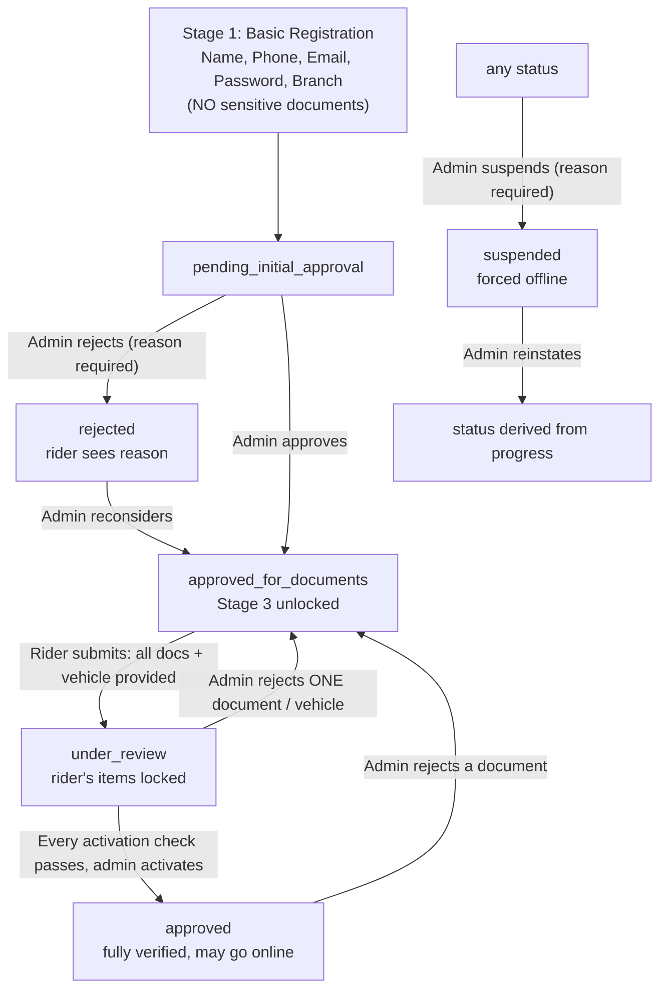

# AHAAR Delivery System — Business Rules Specification

**Document:** `docs/business-rules.md`  
**Date:** November 2026 (Updated with 5-Stage Verification Workflow)  
**Status:** Approved Specification  

---

## 1. Vehicle Eligibility & Track Segregation

AHAAR operates two distinct delivery tracks based on vehicle capability, package volume, and scheduling:

```
┌─────────────────────────────────────────────────────────────────────────────┐
│                          DELIVERY TRACK SEGREGATION                         │
├──────────────────────────────────────┬──────────────────────────────────────┤
│              CAR TRACK               │              BIKE TRACK              │
│       (Subscription Catering)        │        (Instant / Daily Food)        │
├──────────────────────────────────────┼──────────────────────────────────────┤
│ Target: 7, 15, and 30-day meal plans │ Target: Walk-in on-demand meal orders│
│ Volume: 10 to 20 thermal bags/crates │ Volume: 1 to 2 meal packages         │
│ Source: daily_deliveries table       │ Source: orders table (type=instant)  │
│ Dispatch: Batched route (Multi-stop) │ Dispatch: Point-to-point (Direct)    │
│ Schedule: Fixed time slots (Lunch)   │ Schedule: Immediate / ASAP           │
└──────────────────────────────────────┴──────────────────────────────────────┘
```

### 1.1 Enforcement Rules
* **Backend Single Source of Truth:** Vehicle eligibility is enforced strictly in the Laravel API layer:
  - `DailyDelivery` and `DeliveryRun` models reject assignment to any rider whose `driver_profile.vehicle_type !== 'car'`.
  - Instant `Order` models reject assignment to any rider whose `driver_profile.vehicle_type !== 'bike'`.
* **API Filtering:**
  - Car riders querying `GET /api/v1/rider/runs/today` only receive assigned `DeliveryRun` batches.
  - Bike riders querying `GET /api/v1/rider/orders/available` only receive instant orders.
* **Frontend Prohibition:** The Rider App UI dynamically adapts based on the rider's verified vehicle type; however, client-side guards are strictly secondary to backend database validation.

---

## 2. Multi-Branch Architecture (3 Branches)

The system must support all three AHAAR branches. All operational data is partitioned by `branch_id`.

```
┌──────────────────────────────────────────────────────────────────────────┐
│                         MULTI-BRANCH HIERARCHY                           │
└──────────────────────────────────────────────────────────────────────────┘
                  ┌───────────────────────────────┐
                  │       AHAAR Platform          │
                  └──────────────┬────────────────┘
         ┌───────────────────────┼───────────────────────┐
         ▼                       ▼                       ▼
  ┌───────────────┐       ┌───────────────┐       ┌───────────────┐
  │ Branch 1:     │       │ Branch 2:     │       │ Branch 3:     │
  │ Central (RUH) │       │ North (RUH)   │       │ East (RUH)    │
  └───────┬───────┘       └───────┬───────┘       └───────┬───────┘
          │                       │                       │
     Kitchen 1               Kitchen 2               Kitchen 3
     Car Fleet 1             Car Fleet 2             Car Fleet 3
     Bike Fleet 1            Bike Fleet 2            Bike Fleet 3
```

---

## 3. Mandatory 5-Stage Rider Onboarding & Verification Lifecycle



### 3.0 Two different approvals — never confuse them
| Concept | Meaning | Stored as |
|---|---|---|
| `registration_approved` | Stage 2 passed; the rider may submit documents | `driver_profiles.initial_approved_at` (+ `initial_approved_by`) |
| `fully_verified` | Stage 5 passed; the rider is activated | `driver_profiles.approval_status = 'approved'` |

A rider can be `registration_approved` for weeks without being `fully_verified`.

### 3.1 Stage 1 — Basic Rider Registration
* Collects **only**: Full Name, Phone Number, Email, Password + confirmation, Operating Branch.
* **Do NOT** request Iqama, Driving License, Istimara or any other document at sign-up. The API rejects document uploads until Stage 2 is approved.
* The profile is created with `approval_status = 'pending_initial_approval'` and appears immediately in the Admin → Operations → Riders queue under **Needs review**.

### 3.2 Stage 2 — Initial Admin Verification
* The admin reviews name, phone, email and branch.
* **Approve** → `approved_for_documents`, unlocking Stage 3 in the Rider App. Approver and time are recorded.
* **Reject** → `rejected`, with a **mandatory** reason that the rider sees in the app. An admin may later approve a rejected rider.
* **Suspend** → `suspended`, with a **mandatory** reason; available at any stage and forces the rider offline.
* **Reinstate** → lifts a suspension. The new status comes from the rider's progress (`pending_initial_approval`, `approved_for_documents`, `under_review`, or `approved` only if they had already been activated before). Reinstating never skips Stage 5.

### 3.3 Stage 3 — Guided Step-by-Step Document Collection
Only while `approval_status = 'approved_for_documents'`. The Rider App guides the rider through:
1. **Iqama / Identity Document** — number (required), expiry date (required, future), photo or PDF.
2. **Driving License** — number (required), expiry date (required, future), photo or PDF.
3. **Vehicle Information** — **Bike** or **Car**, plate (required), model (optional).
4. **Istimara / Vehicle Registration** — expiry date (required, future), photo or PDF.
5. **Review & Submit.**
* Files: jpeg / png / webp / heic / pdf, max 10 MB.
* *Progress is saved per item on the server*; the rider can leave and resume at the first unfinished step.
* **Submit for review** is refused while any document is missing, rejected or expired, or the vehicle is missing or rejected; the API returns the exact list (`submit_blockers`).
* After submission the status becomes `under_review` and the rider's items are locked.

### 3.4 Stage 4 — Individual Admin Verification
* The admin approves or rejects **each document and the vehicle information separately**. A rejection reason is **mandatory**.
* Document status lifecycle:

| Status | Meaning |
|---|---|
| `not_submitted` | No file yet |
| `submitted` | Uploaded, rider hasn't submitted the application yet |
| `under_review` | Uploaded and the application is with the admin |
| `approved` | Accepted by an admin (locked for the rider) |
| `rejected` | Refused with a reason; the rider must replace it |
| `expired` | Expiry date has passed; it no longer counts as approved |

* A rejection sends the rider back to `approved_for_documents` and offline. **Only the rejected item** has to be replaced; approved items stay approved and cannot be overwritten. The rider then submits again.

### 3.5 Stage 5 — Final Rider Activation & Eligibility Guard
An admin can activate (`approval_status = 'approved'`) **only** when every check passes. The checks are computed in Laravel (`DriverProfile::activationChecks()`), not only in the UI:
1. Initial registration approved.
2. All mandatory documents (Iqama, Driving License, Istimara) approved.
3. No mandatory document expired.
4. Vehicle information approved.
5. Operating branch assigned.
6. User account active and the rider is not suspended or rejected.

A rider can go **online** (`POST /api/v1/rider/status`) only when `approval_status = 'approved'` **and** all six checks still pass (`DriverProfile::canGoOnline()`). An expired document therefore blocks going online immediately, even for an activated rider.

### 3.6 Approval History & Audit Log
* Every step is written to the existing `activity_log` table (log name `rider_onboarding`, subject = the driver profile, causer = the admin or rider): registered, registration approved/rejected, document uploaded/replaced, vehicle saved, submitted for review, document/vehicle approved/rejected, returned to rider, activated, suspended, reinstated, each with from/to status and reason.
* The admin review sheet shows this history as a timeline.
* All transitions live in one service, `App\Services\Rider\RiderOnboarding`. Controllers must not change `approval_status` directly.

---

## 4. Automatic & Manual Delivery Assignment

### 4.1 Car Route Batching (Subscription Catering)
1. **Trigger:** Initiated at each meal slot's cutoff time via `LockCutoffDeliveriesJob`.
2. **Clustering Algorithm:**
   - Filters all `locked` subscription deliveries for that `branch_id`, `delivery_date`, and `slot_id`.
   - Clusters deliveries by geographical sector (`addresses.area` and coordinate proximity).
   - Generates `DeliveryRun` manifests capped at 12–18 stops per car run (calculated for a 2-hour catering slot).
   - Sequences stops by shortest travel path.
3. **Auto-Assignment:** Assigns runs to approved, online Car riders belonging to that branch.
4. **Manual Assignment Override:** Ops dispatchers can view, reassign, or split runs from the Admin Panel.

### 4.2 Bike Dispatch (Instant Orders)
1. **Trigger:** Triggered when an instant order is confirmed by the kitchen (`status = 'confirmed'`).
2. **Broadcast / Claim:**
   - Broadcast to approved, online Bike riders within a 5 km radius of the branch kitchen.
   - Claimed using database pessimistic locking (`lockForUpdate()`).

---

## 5. Package Labeling & Handover Verification

* **Thermal QR Labels:** Each catering bag receives a 3"x2" adhesive thermal label with:
  - High-visibility sequence tag: `ROUTE CR-04 | STOP #07`.
  - Meal Slot Badge: `[LUNCH 12:00-14:00]`.
  - Customer name, district (`area`), and address.
  - Meal breakdown with swap indicators (`was_swapped`).
  - Signed QR Code holding the unique verification token.
* **Handover Verification:**
  - Car driver scans all 15 bags at kitchen pickup -> route transitions to `dispatched`.
  - At customer doorstep, driver scans bag QR -> confirms stop match before handover.

---

## 6. Delivery Confirmation & Exception Handling

* **Photo Proof-of-Delivery (PoD):**
  - Requires rider to be within 150m geo-fence of the destination pin.
  - Direct handover (signature) or Contactless / Doorstep (photo capture).
  - Push notification sent to Customer App with photo link. Zero SMS fees.
* **Unreachable Customer Protocol:**
  - 5-minute countdown timer with push notification + 2 phone calls.
  - If unresolved, driver takes photo of entrance -> marked `failed_attempt`.
  - Driver proceeds to next stop. Undelivered packages returned to branch hub at end of shift.
