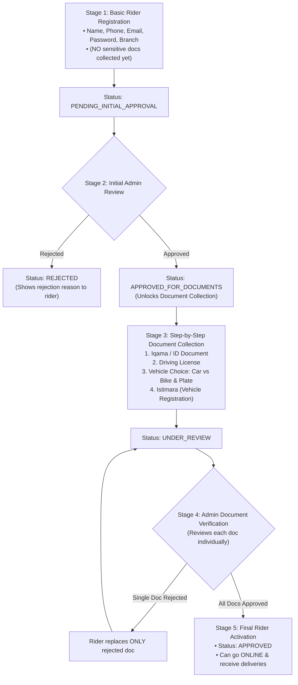

# AHAAR Delivery System — Business Rules Specification

**Document:** `docs/business-rules.md`  
**Date:** November 2026 (Updated with 5-Stage Verification Workflow)  
**Status:** Approved Specification  

---

## 1. Vehicle Eligibility & Track Segregation

AHAAR operates two distinct delivery tracks based on vehicle capability, package volume, and scheduling:

```
┌─────────────────────────────────────────────────────────────────────────────┐
│                          DELIVERY TRACK SEGREGATION                         │
├──────────────────────────────────────┬──────────────────────────────────────┤
│              CAR TRACK               │              BIKE TRACK              │
│       (Subscription Catering)        │        (Instant / Daily Food)        │
├──────────────────────────────────────┼──────────────────────────────────────┤
│ Target: 7, 15, and 30-day meal plans │ Target: Walk-in on-demand meal orders│
│ Volume: 10 to 20 thermal bags/crates │ Volume: 1 to 2 meal packages         │
│ Source: daily_deliveries table       │ Source: orders table (type=instant)  │
│ Dispatch: Batched route (Multi-stop) │ Dispatch: Point-to-point (Direct)    │
│ Schedule: Fixed time slots (Lunch)   │ Schedule: Immediate / ASAP           │
└──────────────────────────────────────┴──────────────────────────────────────┘
```

### 1.1 Enforcement Rules
* **Backend Single Source of Truth:** Vehicle eligibility is enforced strictly in the Laravel API layer:
  - `DailyDelivery` and `DeliveryRun` models reject assignment to any rider whose `driver_profile.vehicle_type !== 'car'`.
  - Instant `Order` models reject assignment to any rider whose `driver_profile.vehicle_type !== 'bike'`.
* **API Filtering:**
  - Car riders querying `GET /api/v1/rider/runs/today` only receive assigned `DeliveryRun` batches.
  - Bike riders querying `GET /api/v1/rider/orders/available` only receive instant orders.
* **Frontend Prohibition:** The Rider App UI dynamically adapts based on the rider's verified vehicle type; however, client-side guards are strictly secondary to backend database validation.

---

## 2. Multi-Branch Architecture (3 Branches)

The system must support all three AHAAR branches. All operational data is partitioned by `branch_id`.

```
┌──────────────────────────────────────────────────────────────────────────┐
│                         MULTI-BRANCH HIERARCHY                           │
└──────────────────────────────────────────────────────────────────────────┘
                  ┌───────────────────────────────┐
                  │       AHAAR Platform          │
                  └──────────────┬────────────────┘
         ┌───────────────────────┼───────────────────────┐
         ▼                       ▼                       ▼
  ┌───────────────┐       ┌───────────────┐       ┌───────────────┐
  │ Branch 1:     │       │ Branch 2:     │       │ Branch 3:     │
  │ Central (RUH) │       │ North (RUH)   │       │ East (RUH)    │
  └───────┬───────┘       └───────┬───────┘       └───────┬───────┘
          │                       │                       │
     Kitchen 1               Kitchen 2               Kitchen 3
     Car Fleet 1             Car Fleet 2             Car Fleet 3
     Bike Fleet 1            Bike Fleet 2            Bike Fleet 3
```

---

## 3. Mandatory 5-Stage Rider Onboarding & Verification Lifecycle



### 3.1 Stage 1 — Basic Rider Registration
* Initial registration collects **only basic identity credentials**:
  - Full Name
  - Phone Number
  - Email Address
  - Password / Confirmation
  - Assigned Branch selection
  - Profile photo (optional)
* **CRITICAL:** Do NOT request Iqama, Driving License, or Istimara during initial sign-up.
* Rider profile is created with `approval_status = 'pending_initial_approval'`.

### 3.2 Stage 2 — Initial Admin Verification
* Admin reviews basic profile details.
* Actions available:
  - **Approve:** Transitions rider to `approved_for_documents`, unlocking Stage 3 in the Rider App.
  - **Reject:** Transitions rider to `rejected` with a mandatory rejection explanation.
  - **Suspend:** Temporarily freezes account.

### 3.3 Stage 3 — Guided Step-by-Step Document Collection
Once unlocked, the Rider App guides the candidate through structured submission:
1. **Iqama / Identity Document:** ID number, expiration date, photo/document upload.
2. **Driving License:** License number, expiration date, photo/document upload.
3. **Vehicle Information:** Selection of **Bike** or **Car** (enforcing catering vs instant delivery rule), vehicle plate number, model, and year.
4. **Istimara (Vehicle Registration):** Registration document upload and expiration date.
* *Progress Preservation:* Draft submissions are stored on the backend so riders can complete steps across multiple sessions.
* Once all steps are completed and submitted, profile status becomes `under_review`.

### 3.4 Stage 4 — Individual Admin Document Review
* Admin reviews each uploaded document individually:
  - `Document Statuses`: `submitted`, `approved`, `rejected`, `expired`.
* If a document is rejected, Admin specifies a rejection reason (e.g. *"Image is blurry; please re-upload clear front side"*).
* The rider is notified and can replace and resubmit **only the rejected document** without repeating the other steps.

### 3.5 Stage 5 — Final Rider Activation & Eligibility Guard
The rider is granted full delivery authorization (`approval_status = 'approved'`) **only when all of the following conditions are met**:
1. Initial basic registration was approved.
2. All mandatory documents are approved by Admin.
3. No document has expired (`expiry_date > now()`).
4. Vehicle information has been validated.
5. The account is active and not suspended.

*Backend Enforcement:* The Laravel API enforces these rules on `POST /api/v1/rider/status` (online toggle). If any condition is violated, the rider is barred from toggling online.

---

## 4. Automatic & Manual Delivery Assignment

### 4.1 Car Route Batching (Subscription Catering)
1. **Trigger:** Initiated at each meal slot's cutoff time via `LockCutoffDeliveriesJob`.
2. **Clustering Algorithm:**
   - Filters all `locked` subscription deliveries for that `branch_id`, `delivery_date`, and `slot_id`.
   - Clusters deliveries by geographical sector (`addresses.area` and coordinate proximity).
   - Generates `DeliveryRun` manifests capped at 12–18 stops per car run (calculated for a 2-hour catering slot).
   - Sequences stops by shortest travel path.
3. **Auto-Assignment:** Assigns runs to approved, online Car riders belonging to that branch.
4. **Manual Assignment Override:** Ops dispatchers can view, reassign, or split runs from the Admin Panel.

### 4.2 Bike Dispatch (Instant Orders)
1. **Trigger:** Triggered when an instant order is confirmed by the kitchen (`status = 'confirmed'`).
2. **Broadcast / Claim:**
   - Broadcast to approved, online Bike riders within a 5 km radius of the branch kitchen.
   - Claimed using database pessimistic locking (`lockForUpdate()`).

---

## 5. Package Labeling & Handover Verification

* **Thermal QR Labels:** Each catering bag receives a 3"x2" adhesive thermal label with:
  - High-visibility sequence tag: `ROUTE CR-04 | STOP #07`.
  - Meal Slot Badge: `[LUNCH 12:00-14:00]`.
  - Customer name, district (`area`), and address.
  - Meal breakdown with swap indicators (`was_swapped`).
  - Signed QR Code holding the unique verification token.
* **Handover Verification:**
  - Car driver scans all 15 bags at kitchen pickup -> route transitions to `dispatched`.
  - At customer doorstep, driver scans bag QR -> confirms stop match before handover.

---

## 6. Delivery Confirmation & Exception Handling

* **Photo Proof-of-Delivery (PoD):**
  - Requires rider to be within 150m geo-fence of the destination pin.
  - Direct handover (signature) or Contactless / Doorstep (photo capture).
  - Push notification sent to Customer App with photo link. Zero SMS fees.
* **Unreachable Customer Protocol:**
  - 5-minute countdown timer with push notification + 2 phone calls.
  - If unresolved, driver takes photo of entrance -> marked `failed_attempt`.
  - Driver proceeds to next stop. Undelivered packages returned to branch hub at end of shift.
