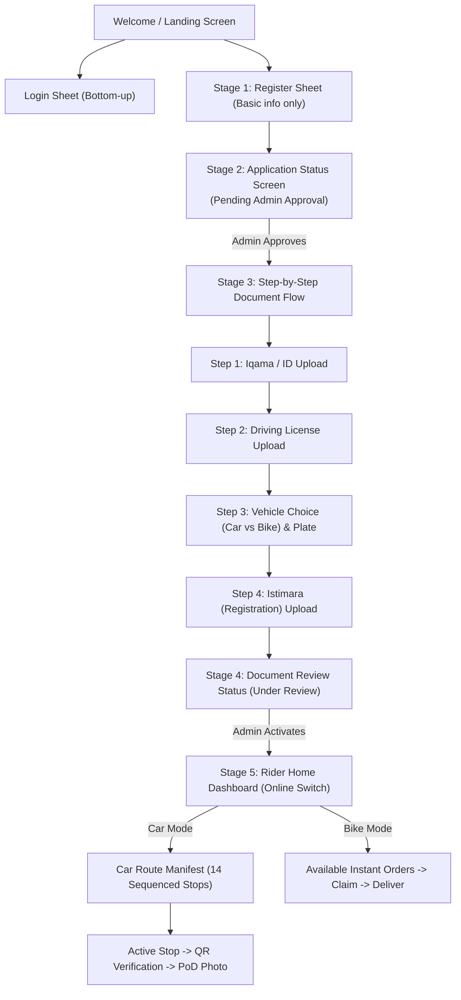

# AHAAR Rider App — UI/UX Design Guidelines & Component Specification

**Document:** `docs/ui-design.md`  
**Date:** November 2026 (Updated with Bottom-Sheet Auth & 5-Stage Onboarding)  
**Status:** Unified Brand & UI Specification  

---

## 1. Design Philosophy & Mobile-First Principles

The AHAAR Rider App is an operational tool built for delivery drivers working in real-world conditions (bright sunlight, moving vehicles, one-handed operation).

### Core Principles
1. **Glanceable Information:** Drivers must understand their next stop, address, and bag ID in under 2 seconds.
2. **Accessible Touch Targets:** Minimum button and interactive element height of **48px** (preferred 52px for primary actions).
3. **High Contrast & Readability:** High-contrast text on solid backgrounds. Avoid faint grey captions or tiny badges.
4. **Resilient Feedback:** Audio and haptic feedback for critical operations (green chime on correct QR scan, loud vibration + red alert on wrong bag scan).

---

## 2. Authentication UI Pattern — Follows AHAAR Customer App

This is a mandatory interaction pattern modeled directly after `ahaar-app/src/components/shared/LoginPrompt.tsx` and `ahaar-app/src/components/ui/Sheet.tsx`:

```
┌────────────────────────────────────────────────────────┐
│             BOTTOM-SHEET AUTHENTICATION PATTERN        │
└────────────────────────────────────────────────────────┘

  • App launches on a branded Welcome / Gateway screen.
  • Tapping "Sign In" or "Apply as Rider" slides up a
    smooth Native Bottom Sheet from the screen bottom.
  • Interactive Keyboard Handling:
    - Sheet uses keyboardBehavior="interactive" via @gorhom/bottom-sheet.
    - Footer button stays pinned above the keyboard while typing.
    - Focused input automatically scrolls into clear view.
    - Zero nested scrolling or keyboard flickering.
    - Safe area insets respected on Android & iOS.
```

---

## 3. Brand Identity & Design Tokens (Unified)

Standardized on the production AHAAR palette from `ahaar-app/src/lib/tokens.js`:

- **Primary Brand Color:** `#FF2B85` (AHAAR Signature Pink / Magenta)
- **Primary Dark:** `#D4006B`
- **Primary Light:** `#FF6AAB`
- **Primary Soft:** `#FFF0F7`
- **Text Primary:** `#1A1A2E` (Navy Charcoal)
- **Text Secondary:** `#4B5563`
- **Text Muted:** `#9CA3AF`
- **Background:** `#FFFFFF`
- **Surface Muted:** `#F9F9F9`
- **Border:** `#F0E0EA`
- **Status Success (Online/Delivered):** `#059669` (Emerald)
- **Status Warning (Pending/Under Review):** `#D97706` (Amber)
- **Status Danger (Wrong Bag/Rejected):** `#EF4444` (Red)
- **Status Info (En Route/Navigating):** `#2563EB` (Blue)

---

## 4. Reusable UI Components Suite

Ported directly from `ahaar-app/src/components/ui`:
* `Button.tsx`: Variants (`primary`, `secondary`, `outline`, `danger`), sizes (`sm`, `md`, `lg`), loading state.
* `Badge.tsx`: Pill badges with status variants (`success`, `warning`, `danger`, `info`, `muted`).
* `Card.tsx`: Card surfaces with elevation and borders.
* `Input.tsx` & `PasswordInput.tsx`: Accessible, auto-validating text inputs (switches to `BottomSheetTextInput` when inside sheets).
* `Sheet.tsx`: Bottom sheets with smooth gesture dismiss and interactive keyboard lifting.
* `States.tsx`: `EmptyState`, `ErrorState`, `LoadingState` handlers.

---

## 5. Screen & Flow Architecture



### 5.1 Welcome & Authentication Gateway
* Clean branded splash screen with AHAAR logo.
* Two prominent buttons:
  - "Sign In as Rider" (opens Login bottom sheet).
  - "Apply as New Rider" (opens Register bottom sheet).

### 5.2 Application Status Screen (Stage 2 & 4)
* Visual state cards:
  - `Pending Initial Review`: Clear explanation that Admin is reviewing basic details.
  - `Rejected`: Prominent red alert box displaying Admin's exact rejection reason.
  - `Documents Unlocked`: Celebratory banner leading to Stage 3 document submission.
  - `Documents Under Review`: Checklist showing individual document verification badges.

### 5.3 Step-by-Step Document Collection Wizard (Stage 3)
* Multi-step progress bar (Step 1 to 4).
* Step 1: Iqama (ID Number, Expiration Date, Document Photo).
* Step 2: Driving License (License Number, Expiration Date, Document Photo).
* Step 3: Vehicle Type Selection (**Bike** for Regular/Instant Orders vs **Car** for Subscription Catering Runs), Vehicle Plate, Model.
* Step 4: Istimara / Vehicle Registration (Expiration Date, Document Photo).
* Each step validates with Zod independently and saves draft progress.

### 5.4 Rider Dashboard & Shift Operations (Stage 5)
* Prominent Online/Offline toggle at header.
* Shift summary: Today's completed deliveries, earnings, assigned route.
* Quick action: "Open Today's Route (14 Stops)" or "View Available Instant Orders".

### 5.5 Active Stop & Camera QR Verification
* Customer name, district, address, and special delivery notes.
* "Navigate" action launching Google Maps / Waze.
* "Scan Bag to Verify" opening camera scanner with real-time match feedback (audio + vibration).
* Proof-of-Delivery camera shutter for doorstep photo.
* 5-minute countdown exception modal for unreachable customers.
