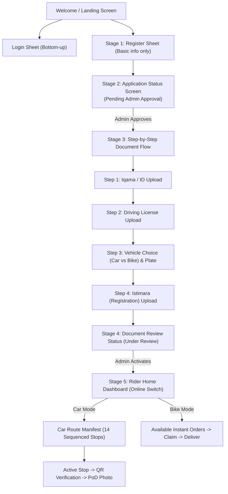

# AHAAR Rider App — UI/UX Design Guidelines & Component Specification

**Document:** `docs/ui-design.md`  
**Date:** November 2026 (Updated with Bottom-Sheet Auth & 5-Stage Onboarding)  
**Status:** Unified Brand & UI Specification  

---

## 1. Design Philosophy & Mobile-First Principles

The AHAAR Rider App is an operational tool built for delivery drivers working in real-world conditions (bright sunlight, moving vehicles, one-handed operation).

### Core Principles
1. **Glanceable Information:** Drivers must understand their next stop, address, and bag ID in under 2 seconds.
2. **Accessible Touch Targets:** Minimum button and interactive element height of **48px** (preferred 52px for primary actions).
3. **High Contrast & Readability:** High-contrast text on solid backgrounds. Avoid faint grey captions or tiny badges.
4. **Resilient Feedback:** Audio and haptic feedback for critical operations (green chime on correct QR scan, loud vibration + red alert on wrong bag scan).

---

## 2. Authentication UI Pattern — Follows AHAAR Customer App

This is a mandatory interaction pattern modeled directly after `ahaar-app/src/components/shared/LoginPrompt.tsx` and `ahaar-app/src/components/ui/Sheet.tsx`:

```
┌────────────────────────────────────────────────────────┐
│             BOTTOM-SHEET AUTHENTICATION PATTERN        │
└────────────────────────────────────────────────────────┘

  • App launches on a branded Welcome / Gateway screen.
  • Tapping "Sign In" or "Apply as Rider" slides up a
    smooth Native Bottom Sheet from the screen bottom.
  • Interactive Keyboard Handling:
    - Sheet uses keyboardBehavior="interactive" via @gorhom/bottom-sheet.
    - Footer button stays pinned above the keyboard while typing.
    - Focused input automatically scrolls into clear view.
    - Zero nested scrolling or keyboard flickering.
    - Safe area insets respected on Android & iOS.
```

---

## 3. Brand Identity & Design Tokens (Rider Palette)

Standardized on the AHAAR Rider App design tokens:

| Token | Color | Usage |
|---|---|---|
| **Primary** | `#FF7A00` | Main brand actions, active navigation, key highlights |
| **Secondary** | `#E04E0C` | Strong accents, selected emphasis, important actions |
| **Text** | `#1F1F1F` | Main text and headings |
| **Background** | `#FFFFFF` | Main screen background |
| **Surface** | `#FFF1E6` | Soft cards, grouped sections, subtle highlighted areas |

### Contrast Rules
* Do not use white text on `#FF7A00` for normal-sized text; its contrast is insufficient.
* Prefer `#1F1F1F` text/icons on `#FF7A00`.
* White text on `#E04E0C` is suitable for prominent badges and hero cards.
* Use accessible contrast for all text, icons, borders, and interactive states.
* Do not use brand orange to communicate every status. Use separate semantic status colors.

### Semantic Status Colors
* **Status Success (Online/Delivered):** `#059669` (Emerald, soft: `#ECFDF5`)
* **Status Warning (Pending/Under Review):** `#D97706` (Amber, soft: `#FFFBEB`)
* **Status Danger (Wrong Bag/Rejected):** `#DC2626` (Red, soft: `#FEF2F2`)
* **Status Info (En Route/Navigating):** `#2563EB` (Blue, soft: `#EFF6FF`)
* **Disabled / Inactive:** `#8C8C8C` / `#E5E7EB`

---

## 4. Reusable UI Components Suite

Ported directly from `ahaar-app/src/components/ui`:
* `Button.tsx`: Variants (`primary`, `secondary`, `outline`, `danger`), sizes (`sm`, `md`, `lg`), loading state.
* `Badge.tsx`: Pill badges with status variants (`success`, `warning`, `danger`, `info`, `muted`).
* `Card.tsx`: Card surfaces with elevation and borders.
* `Input.tsx` & `PasswordInput.tsx`: Accessible, auto-validating text inputs (switches to `BottomSheetTextInput` when inside sheets).
* `Sheet.tsx`: Bottom sheets with smooth gesture dismiss and interactive keyboard lifting.
* `States.tsx`: `EmptyState`, `ErrorState`, `LoadingState` handlers.

---

## 5. Screen & Flow Architecture



### 5.1 Welcome & Authentication Gateway
* Clean branded splash screen with AHAAR logo.
* Two prominent buttons:
  - "Sign In as Rider" (opens Login bottom sheet).
  - "Apply to Deliver" (opens Register bottom sheet).
* The Register sheet asks **only** for Name, Email, Phone, Branch, Password and Confirm Password. It scrolls smoothly above the keyboard so every field and the submit button stay reachable.
* After sign-in / registration the app routes by `approval_status`:
  - `approved` → Dashboard (tabs)
  - `approved_for_documents` → Document wizard
  - anything else → Application Status

### 5.2 Application Status Screen
* A 5-step tracker: Registered → Initial approval → Documents → Verification → Active, showing done / current / blocked.
* One clear state card per status:
  - `pending_initial_approval`: "Application received", what happens next. Auto-refreshes.
  - `approved_for_documents`: "Continue your documents" button. If `action_required`, a red "Action required" card names what was rejected.
  - `under_review`: "Documents under review" with the submission time and a read-only view of the documents. Auto-refreshes.
  - `approved`: "You're verified" with a button to the Dashboard.
  - `rejected` / `suspended`: prominent red card with the admin's exact reason and a support contact.
  - `expired_documents`: explains which document must be renewed.
* Pull to refresh and Logout are always available.

### 5.3 Step-by-Step Document Collection Wizard (Stage 3)
* Progress bar for 5 steps: 1 Iqama, 2 Driving License, 3 Vehicle, 4 Istimara, 5 Review & Submit.
* Opens at the first unfinished step (not submitted, rejected or expired), so a rider can leave and continue later.
* Each document step shows its status badge, the admin's rejection reason if rejected, the number field (Iqama & License only), the expiry date (YYYY-MM-DD, must be in the future), and a gallery/camera picker with preview, Replace and an upload progress bar.
* An already-saved, unchanged step just continues and does not re-upload.
* Approved items are read-only with a lock note. While the application is `under_review`, the whole wizard is read-only.
* Vehicle step: **Car** → plan/subscription deliveries only; **Bike** → regular/daily instant deliveries only.
* The Review step lists every item with its status and the server's `submit_blockers`. Submit stays disabled until there are none.

### 5.4 Rider Dashboard & Shift Operations (Stage 5)
* Prominent Online/Offline toggle at header.
* Shift summary: Today's completed deliveries, earnings, assigned route.
* Quick action: "Open Today's Route (14 Stops)" or "View Available Instant Orders".

### 5.5 Active Stop & Camera QR Verification
* Customer name, district, address, and special delivery notes.
* "Navigate" action launching Google Maps / Waze.
* "Scan Bag to Verify" opening camera scanner with real-time match feedback (audio + vibration).
* Proof-of-Delivery camera shutter for doorstep photo.
* 5-minute countdown exception modal for unreachable customers.

### 5.6 Admin Panel — Operations → Riders
* **Queue tabs with counts:** Needs review (Stage 2), Documents review (Stage 4), Waiting on rider, Active, Rejected, Suspended, All. Search by name/phone/email and filter by vehicle.
* **Row:** rider, branch, vehicle, stage badge + next-action hint, documents progress (e.g. 2/3 approved), applied date, online dot. Clicking the row opens the review panel.
* **Review panel:**
  - Stage stepper and applicant details.
  - Stage 2: **Approve registration** / **Reject** (reason dialog, required).
  - Stage 4: one card per document and one for the vehicle, each with View file, Approve and Reject (reason required), and who reviewed it and when.
  - Stage 5: activation checklist (✓/✗ for each server check) and **Activate rider**, enabled only when every check passes.
  - Danger zone: Suspend (reason required) / Reinstate / Reject application.
  - History timeline of every step with actor, reason and time.
